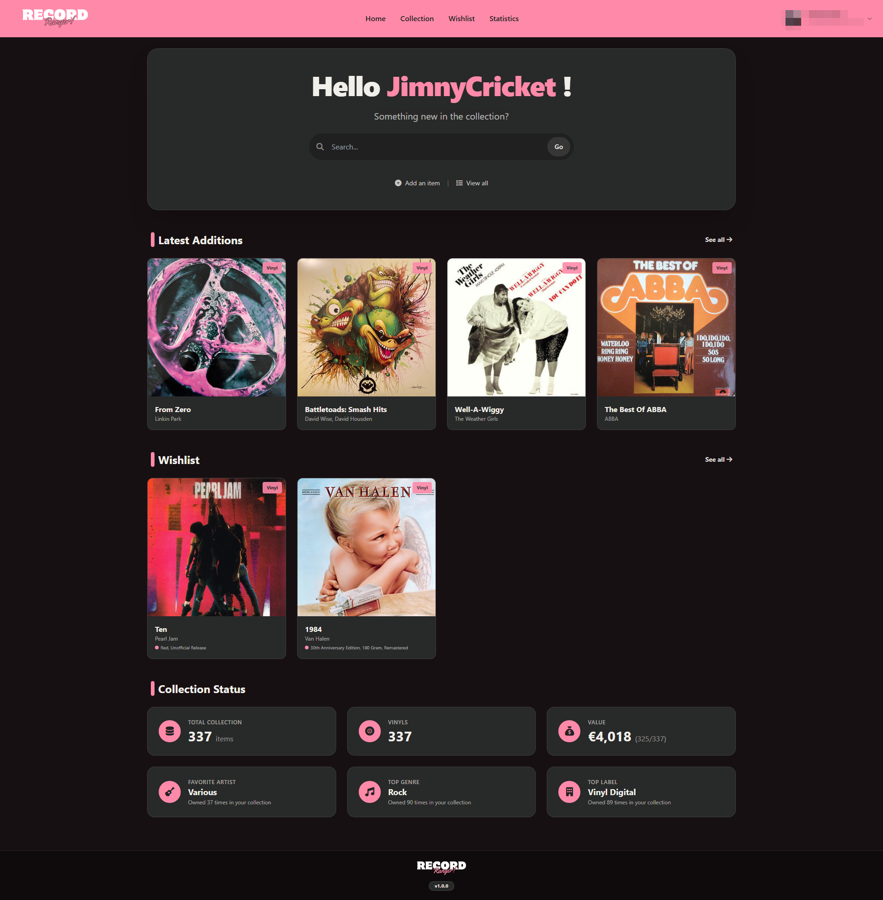
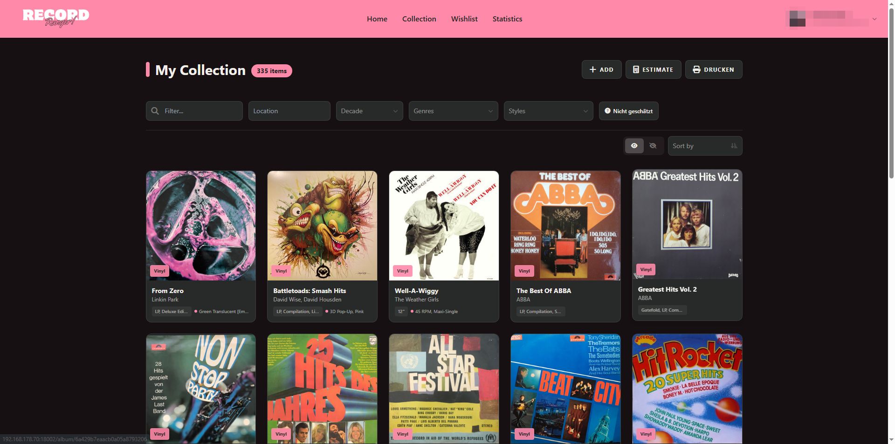
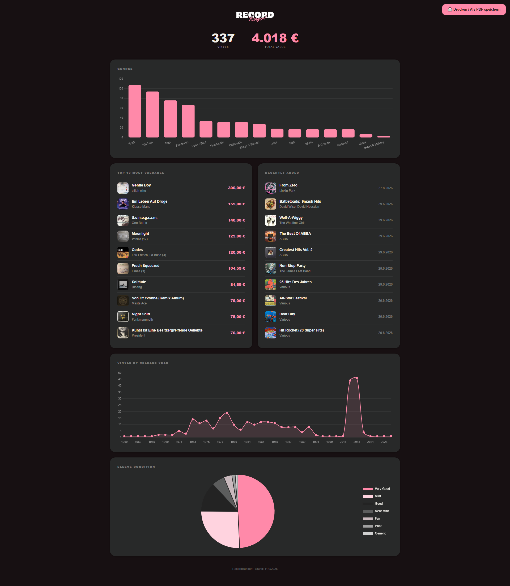
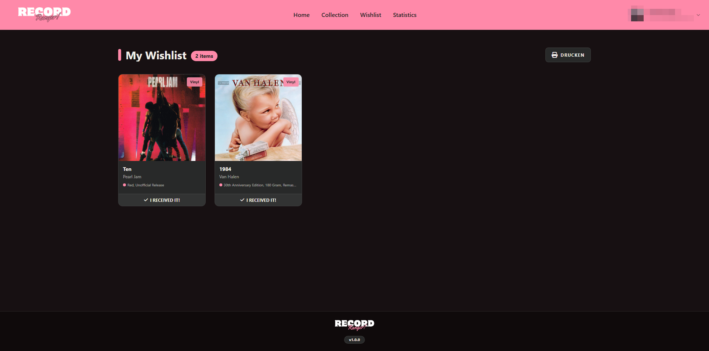

<div align="center">


<br/><br/>

# RecordRanger!

### A self-hosted collection manager for vinyl records

Keep track of your records, your wishlist and what your collection is worth, with metadata
and market prices from Discogs. Your data stays on your own server.

<p>
  
  
  
  
  
</p>

**[Overview](#-overview)** ·
**[Features](#-features)** ·
**[Screenshots](#-screenshots)** ·
**[Getting Started](#-getting-started)** ·
**[Unraid](#-unraid)** ·
**[Configuration](#-configuration)** ·
**[Roadmap](#-roadmap)**

</div>

<br/><br/>

##  Overview

**RecordRanger!** manages a vinyl collection on your home server. Add a record by searching
Discogs, scanning its barcode or typing it in by hand, and RecordRanger stores the tracklist,
pressing details and shelf location together with an estimated market value.

One admin maintains the collection. Other accounts can browse it, and the admin decides which
records and genres they get to see.

<br/>

> [!WARNING]
> RecordRanger is meant for your home network. Security hardening is in progress, so please
> don't expose it directly to the internet for now.

> [!NOTE]
> This is a private project and is **not affiliated with Discogs**. Value estimates are based
> on Discogs marketplace data and are only a guide.

<br/><br/>

##  Features

- **Adding records** – Search Discogs, paste a Discogs link, scan a barcode or enter a record manually.
- **Importing** – Bring in your Discogs collection or wishlist, or a CSV export from Musik-Sammler.
- **Duplicate check** – Asks when a record with the same Discogs ID or the same title and artist already exists, then raises the quantity or adds a separate entry, whichever you choose.
- **Organization** – Shelf location, sleeve condition, quantity, comments, your own photos, and filters for genre, style and decade.
- **Value estimates** – Lowest marketplace price from Discogs, or a condition-based price suggestion if you set a token, converted into your preferred currency (EUR, USD or GBP).
- **Statistics** – Genre distribution, sleeve condition, records by release year, most valuable records and latest additions.
- **Wishlist** – Keep track of future finds and move them into your collection once you own them.
- **Print and PDF** – Export your collection or wishlist as a printable list.
- **Access control** – Login with admin and guest accounts, an IP blocklist, and visibility settings for individual records and genres.
- **Backups** – Manual export and import, plus scheduled backups with a retention limit.
- **Themes** – Several color themes, each with light and dark mode.
- **Five languages** – English, German, French, Spanish and Italian, switchable per user.

<br/><br/>

##  Screenshots

<div align="center">

| Dashboard | Collection |
| :---: | :---: |
|  |  |

| Statistics | Wishlist |
| :---: | :---: |
|  |  |

</div>

<br/><br/>

##  Tech Stack

| **Area** | **Technology** | **Purpose** |
| :--- | :--- | :--- |
| **Backend** |  | Node.js and Express, login with JWT cookies, i18next for translations |
| **Frontend** |  | Server-rendered EJS templates, Tailwind CSS, charts with Chart.js |
| **Database** |  | MongoDB with Mongoose |
| **Data source** | Discogs API | Metadata, tracklists and market prices |
| **Container** |  | Image published to GHCR via GitHub Actions |

<br/><br/>

##  Getting Started

### Prerequisites

- Docker with Compose

### Installation

```bash
git clone https://github.com/xXJimnyCricketXx/RecordRanger.git
cd RecordRanger
cp .env.example .env    # set PASSJWT
docker compose up -d
```

The app is now available at:

```text
http://localhost:3099
```

On first start, the setup page creates the admin account or restores an existing backup.

### More documentation

- [Getting started](docs/getting-started.md) – Manual installation with Node.js and MongoDB.
- [Docker deployment](docs/docker.md) – Docker Compose, the pre-built image and troubleshooting.
- [API configuration](docs/api-keys.md) – How to get a Discogs token.

<br/><br/>

##  Unraid

The image is built by GitHub Actions on every push to `main` and on `v*` tags
([docker-publish.yml](.github/workflows/docker-publish.yml)):

```text
ghcr.io/xxjimnycricketxx/recordranger:latest
```

RecordRanger needs a MongoDB instance, so install a MongoDB container first and note its IP address.

**1. Install the template.** On the Unraid console:

```bash
curl -fsSL -o /boot/config/plugins/dockerMan/templates-user/recordranger.xml https://raw.githubusercontent.com/xXJimnyCricketXx/RecordRanger/main/unraid-template/recordranger.xml
```

**2. Create the container.** Go to *Docker → Add Container → Template: recordranger*, then set the MongoDB URL and `PASSJWT`.

Port `18002` and the appdata paths under `/mnt/user/appdata/recordranger` are pre-filled.

**Updates:** *Docker → Check for Updates*, then apply the update for RecordRanger.

<br/><br/>

##  Configuration

Configuration is handled through environment variables. See [`.env.example`](.env.example) for a starting point.

| Variable | Required | Description |
| --- | :---: | --- |
| `MONGODB_URL` | ✅ | Connection string for your MongoDB instance |
| `PASSJWT` | ✅ | Long random secret used to sign login tokens |
| `PROD` | ❌ | Set to `true` **only** if you serve the app over HTTPS through a reverse proxy, otherwise `false`. Client IP addresses are only read from the proxy headers when this is `true` |
| `VINYL_PORT` | ❌ | Port the app listens on inside the container (default: `3099`) |
| `BASE_URL` | ❌ | Base path for serving on a sub-path, leave empty to serve from root |
| `DISCOGS_TOKEN` | ❌ | Discogs token for higher rate limits and condition-based price suggestions. See [API configuration](docs/api-keys.md) |

> [!IMPORTANT]
> Set `PASSJWT` to your own random secret, for example the output of `openssl rand -hex 32`. The app refuses to start with the example value.
> The barcode scanner needs HTTPS, because browsers only allow camera access on secure pages.

<br/><br/>

##  Project Structure

```text
RecordRanger/
├── app.js               # Entry point: middleware, routes, database, sockets
├── config/              # Database connection, constants, color themes
├── controllers/         # Login and logout
├── docs/                # Setup guides and images
├── locales/             # Translations (de, en, es, fr, it)
├── middleware/          # Authentication and settings
├── models/              # Mongoose schemas
├── public/              # Static files and uploads
├── public-tpl/          # Web app manifest and service worker templates
├── routes/              # Albums, admin, backups, settings, setup
├── unraid-template/     # Unraid container template
├── utils/               # Backups, currency conversion, migrations, visibility
├── views/               # EJS templates
├── docker-compose.yml
└── Dockerfile
```

<br/><br/>

##  Roadmap

| **Version** | **Features** | **Status** |
| :---: | :--- | :---: |
| **1.1.1** | <ul><li>All pages, dialogs and print views follow your language, dates and numbers too</li><li>Admin actions show a clear success or error message</li><li>English is the default language for new users</li><li>Inverted collection filter no longer hides everything without an active filter</li><li>Invalid links show a proper page instead of an error</li></ul> |  |
| **1.1.0** | <ul><li>Runs on Node.js 24, with major dependency upgrades</li><li>Refuses to start with an example login secret</li><li>Login throttling per client, which spoofed headers cannot bypass</li><li>IP blocking only trusts proxy headers behind a configured proxy</li><li>Live updates are limited to admins</li><li>Automated tests run before every image build</li></ul> |  |
| **1.0.2** | <ul><li>Duplicates are always detected, and a new entry never overwrites an existing one</li><li>Backup restore validates the file first, keeps a snapshot and rolls back on failure</li><li>The app starts and recovers on its own when the database is unavailable</li><li>Scheduled backups run reliably and catch up after downtime</li><li>Collection value converts between currencies correctly</li><li>Login right after first-run setup works</li></ul> |  |
| **1.0.1** | <ul><li>First-run setup is locked once an admin exists</li><li>Avatar uploads only accept real image files</li><li>Fixed cross-site scripting issues in the admin panel, statistics and duplicate check</li><li>Hidden records and genres stay hidden on every page</li><li>Estimating, importing and editing are admin-only</li><li>Stricter input validation and updated dependencies</li></ul> |  |
| **1.0.0** | <ul><li>Discogs search, barcode scanner and manual entry</li><li>Discogs and Musik-Sammler import</li><li>Value estimates with currency conversion</li><li>Statistics, duplicate check, print and PDF export</li><li>Scheduled backups, color themes, five languages</li><li>Docker image and Unraid template</li></ul> |  |

See the [open issues](../../issues) for planned features and known problems.

<br/><br/>

##  Development

Requires Node.js 24 or newer and a running MongoDB. Set `MONGODB_URL` in `.env` to your local instance, then run:

```bash
npm install
npm run dev
```

The app reloads on changes.

The tests need a MongoDB on `localhost:27017` and only use a database named `recordranger_test`, which they wipe. Set `TEST_MONGODB_URL` to use another instance.

```bash
npm test
```

<br/><br/>

##  Contributing

Issues and pull requests are welcome. Please open an issue first for larger changes.

<br/><br/>

##  License

This project is licensed under the **MIT License**. See [`LICENSE`](LICENSE) for details.

RecordRanger is based on [DVinyl](https://github.com/Kyonew/DVinyl).

<br/><br/>

---

<br>

<div align="center">

<a href="https://github.com/xXJimnyCricketXx">
  
</a>
<a href="https://cricketcode.de">
  
</a>

</div>
